# ASZ Management Suite

**Verwaltungssoftware für eine Studentenverbindung: Mitglieder, Getränkekasse („Bierwart“),
Inventur und Finanzbuchungen – mit PDF-Berichten auf Knopfdruck.**
Spring-Boot-Backend, React-Frontend, PostgreSQL; läuft komplett in Docker Compose und wird
selbst gehostet.

> Dieses Repository ist das **öffentliche Schaufenster** des Projekts. Der vollständige Quellcode
> liegt in einem privaten Repository; hier finden sich Architektur, Designentscheidungen,
> Screenshots und ausgewählte Code-Auszüge. **Einblick in den vollständigen Code gebe ich gern
> auf Anfrage**, z. B. im Rahmen eines Bewerbungsgesprächs.

  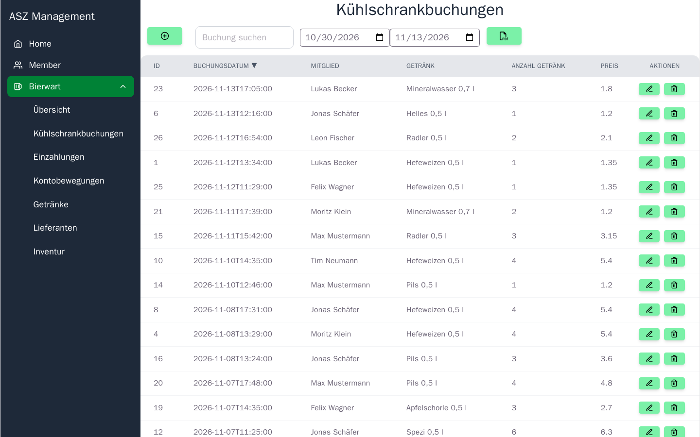

## Funktionen

- **Mitgliederverzeichnis:** Status (Bundesbruder, Alter Herr, Gast …), Kontaktdaten, Adresse,
  Eintrittsdaten und das persönliche Getränkekonto jedes Mitglieds.
- **Kühlschrankbuchungen:** mehrere Getränke pro Person in einem Dialog buchen; der Preis wird
  aus dem Verkaufspreis berechnet und sofort vom Mitgliedskonto abgezogen, der Bestand sinkt.
- **Einzahlungen:** Guthaben per Überweisung (Bierkonto) oder bar (Bierkasse) aufladen.
- **Kontobewegungen:** Rechnungen von Lieferanten mit Rechnungsnummer, Konto und Notiz.
- **Kassenstände:** Jede Buchung erzeugt automatisch einen neuen Stand von Bierkonto, Bierkasse
  und Inventarwert – eine lückenlose, nachvollziehbare Historie.
- **Getränke & Lieferanten:** Einkaufspreis, Aufschlagsfaktor, berechneter Verkaufspreis,
  Bestand und Lagerwert.
- **Inventur:** Beim Start wird der Sollbestand eingefroren, gezählt wird in Etappen; sobald alles
  gezählt ist, wird die Inventur abgeschlossen, Schwund berechnet und der Bestand korrigiert.
- **PDF-Berichte:** Bierliste pro Mitglied für einen frei wählbaren Zeitraum und
  Inventurbericht mit Schwund. → [Beispiel Bierliste](docs/beispiele/bookings-report.pdf),
  [Beispiel Inventur](docs/beispiele/inventory-report.pdf)

→ Fachlogik und Buchungsabläufe im Detail: [docs/bierwart.md](docs/bierwart.md)

## Technik

| Bereich   | Technik                                                                 |
| --------- | ----------------------------------------------------------------------- |
| Backend   | Java 17, Spring Boot 4 (Web MVC, Data JPA / Hibernate), Maven           |
| Datenbank | PostgreSQL 16                                                           |
| Frontend  | React 19, TypeScript (schrittweise Migration von JavaScript), Vite, Tailwind CSS 4, React Router |
| Berichte  | OpenPDF (serverseitig erzeugte PDFs)                                    |
| Logging   | SLF4J + Logback mit rotierenden Logdateien                              |
| Betrieb   | Docker Compose: Nginx (Frontend + Reverse Proxy), Spring Boot, PostgreSQL |

## Highlights

- **Automatische Kassenstände als Prüfpfad:** Einzahlungen, Getränkebuchungen, Rechnungen und
  Inventurkorrekturen schreiben jeweils einen neuen Kassenstand mit Begründung; alte Stände
  werden nie überschrieben. Ändern oder Löschen einer Buchung erzeugt eine Korrektur- bzw.
  Rückbuchung statt stiller Änderungen. → [BwAccountSnapshotService.java](code/backend/bierwart/BwAccountSnapshotService.java)
- **Geldbeträge als `BigDecimal`:** keine Rundungsfehler durch Gleitkommazahlen bei Preisen,
  Kontoständen und Lagerwerten.
- **Inventur mit eingefrorenem Sollbestand:** Startbestand und Stückwert werden beim Anlegen
  der Inventur gespeichert, sodass spätere Preisänderungen das Ergebnis nicht verfälschen.
  → [InventoryService.java](code/backend/bierwart/InventoryService.java)
- **PDF-Berichte ohne Umweg:** Die Bierliste aggregiert Einzahlungen und Getränke pro Mitglied
  im gewählten Zeitraum, markiert negative Kontostände rot und wird direkt im Browser geöffnet.
  → [BookingsReportService.java](code/backend/reports/BookingsReportService.java)
- **Eine Origin für Frontend und API:** Nginx liefert die React-App aus und leitet die
  API-Pfade an das Backend weiter; das Backend ist von außen nicht direkt erreichbar.
  → [nginx.conf](code/infra/nginx.conf)
- **Schlanke, sichere Container:** Multi-Stage-Builds (Maven bzw. Node nur zum Bauen), Backend
  läuft als Nicht-Root-Benutzer. → [Dockerfiles](code/infra/)
- **Lizenz-Compliance automatisiert:** Jeder Build prüft die Lizenzen aller Abhängigkeiten
  (Maven: `license-maven-plugin`, npm: `license-checker`) und erzeugt die Lizenzhinweise
  (`THIRD_PARTY_LICENSES.txt`) automatisch; GPL/AGPL lassen den Build fehlschlagen.
- **Wiederverwendbare Frontend-Bausteine:** generisches, typisiertes Sortieren
  ([sortUtils.tsx](code/frontend/sortUtils.tsx)), gemeinsames Speichern/Löschen
  ([crudUtils.jsx](code/frontend/crudUtils.jsx)), Suche und Sortierung in allen Tabellen.

## Screenshots

Alle Screenshots zeigen fiktive Demodaten.

**Startseite und Mitglieder:**

| Startseite                                                                    | Mitgliederverzeichnis                                                              | Mitglied bearbeiten                                                                     |
| ----------------------------------------------------------------------------- | ---------------------------------------------------------------------------------- | --------------------------------------------------------------------------------------- |
| 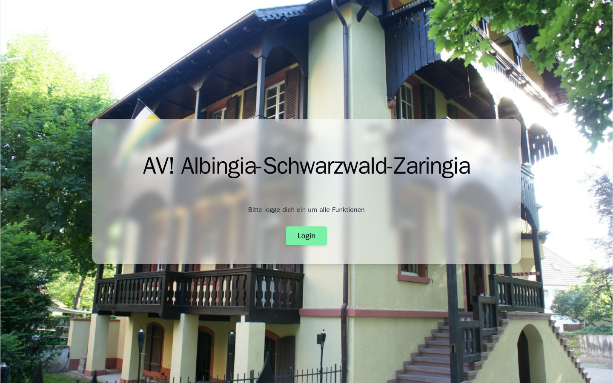 | 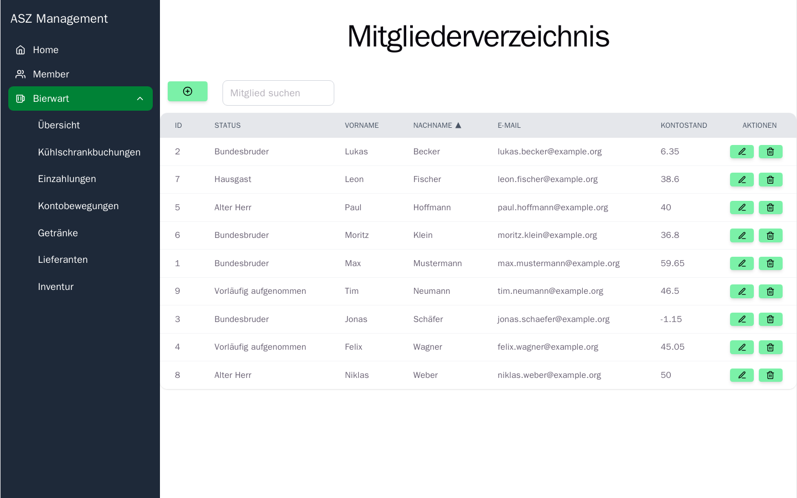 | 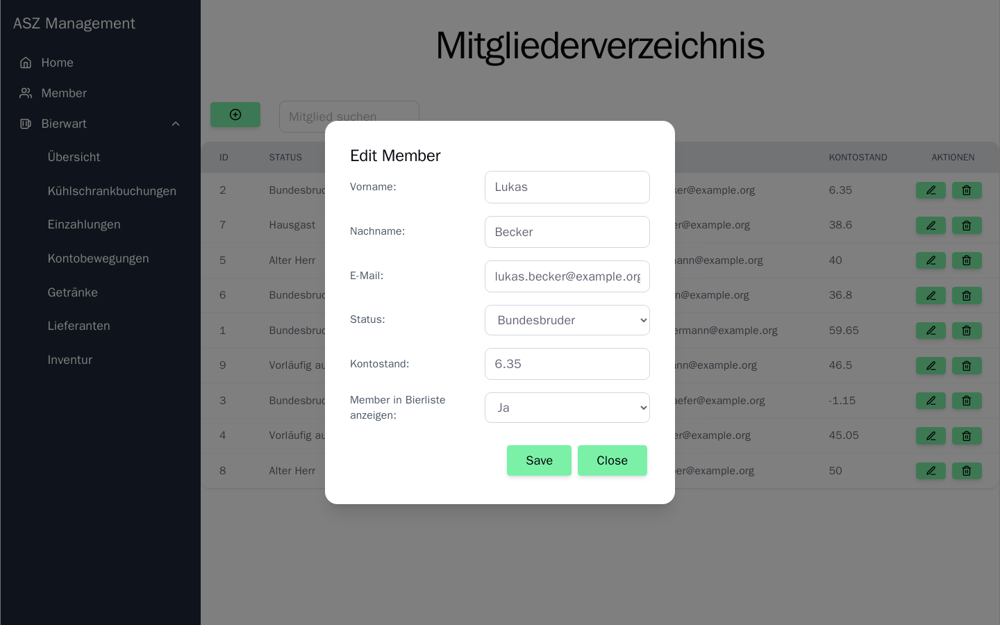 |

**Bierwart – Buchungen und Finanzen:**

| Kühlschrankbuchungen                                                                   | Buchung erfassen                                                                                     | Kassenstände                                                                                |
| -------------------------------------------------------------------------------------- | ---------------------------------------------------------------------------------------------------- | ------------------------------------------------------------------------------------------- |
|  | 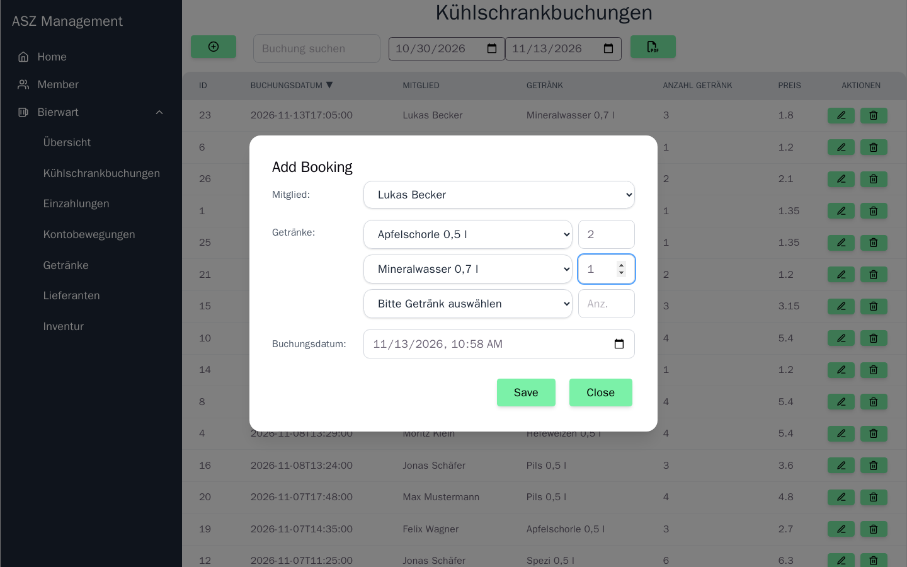 | 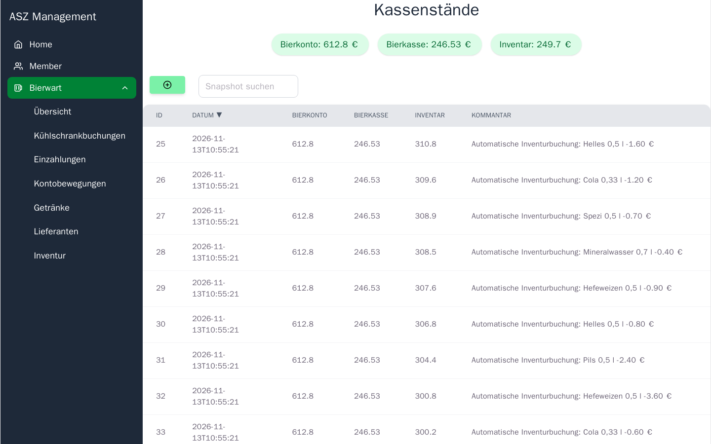 |

| Einzahlungen                                                                      | Kontobewegungen                                                                                  | Lieferanten                                                                       |
| --------------------------------------------------------------------------------- | ------------------------------------------------------------------------------------------------ | --------------------------------------------------------------------------------- |
| 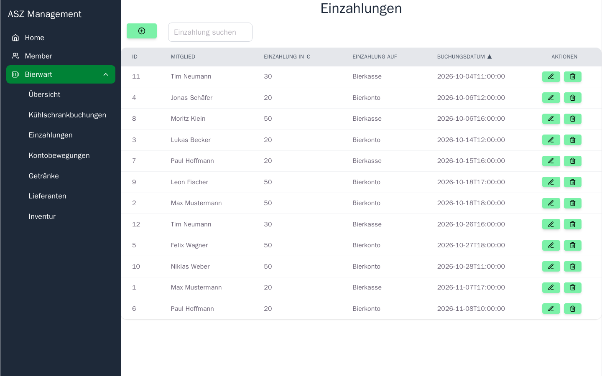 | 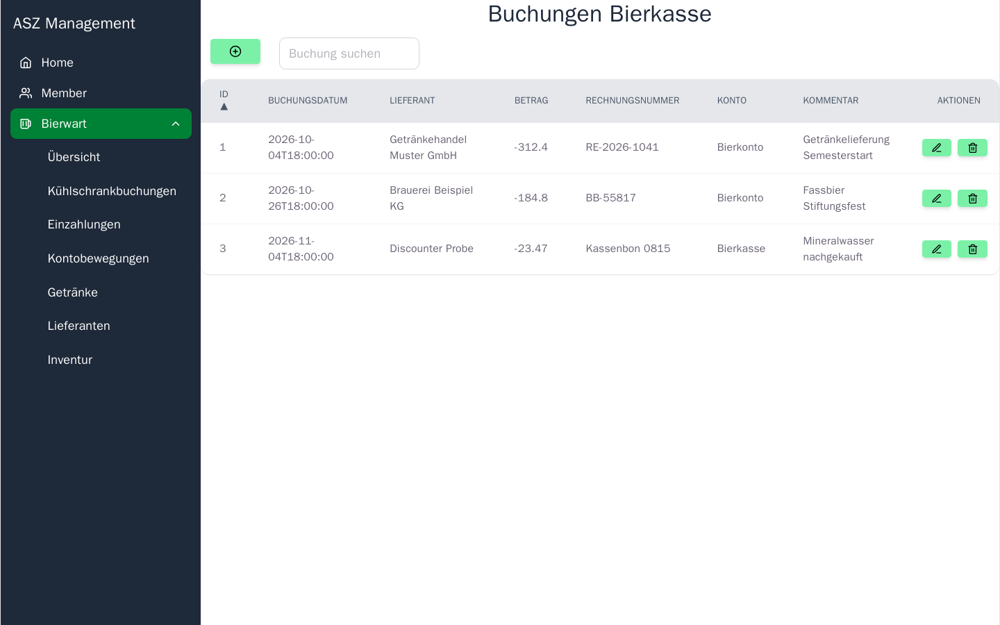 | 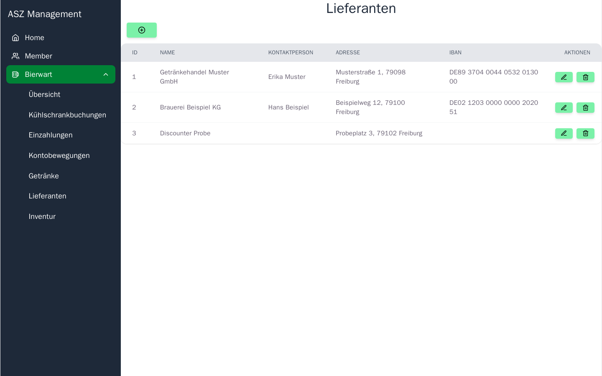 |

**Getränke und Inventur:**

| Getränke                                                                         | Inventuren                                                                      | Zählen                                                                                         |
| -------------------------------------------------------------------------------- | ------------------------------------------------------------------------------- | ---------------------------------------------------------------------------------------------- |
| 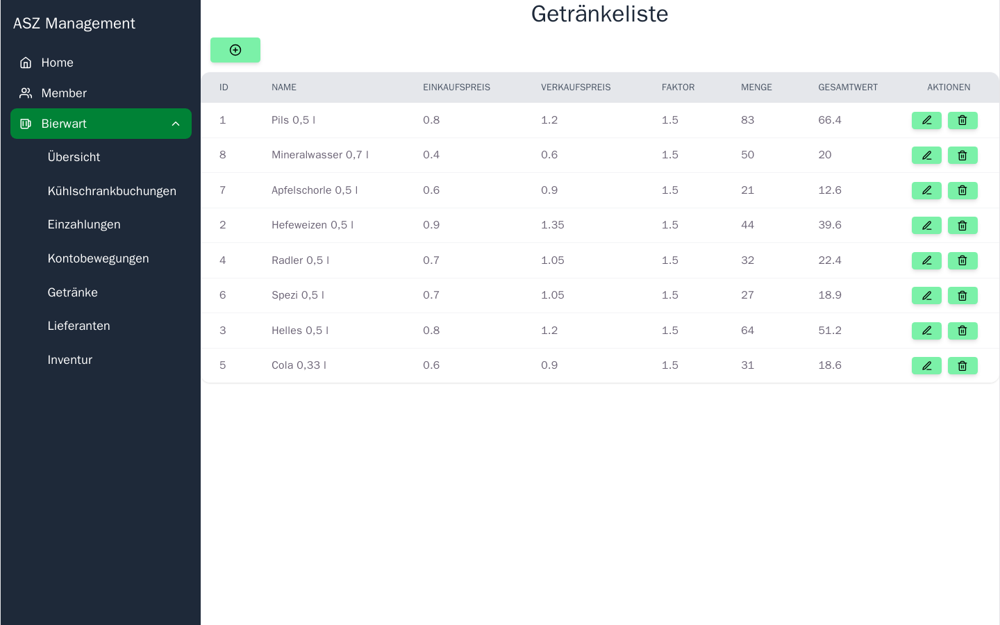 | 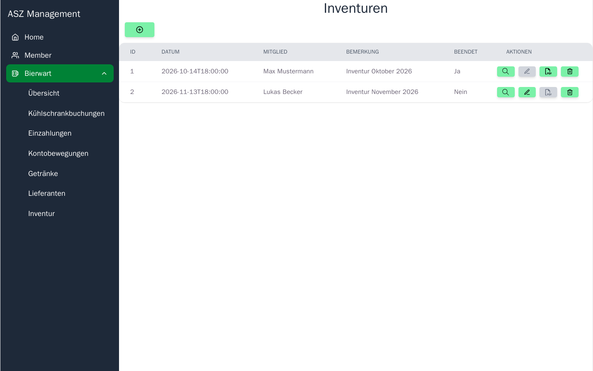 | 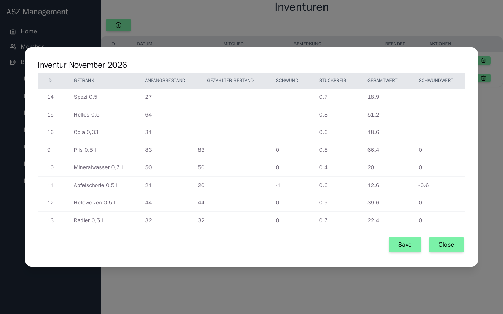 |

## Inhalt dieses Repositorys

| Pfad                                             | Inhalt                                                      |
| ------------------------------------------------ | ----------------------------------------------------------- |
| [docs/bierwart.md](docs/bierwart.md)             | Getränkekasse, Kassenstände und Inventur im Detail          |
| [docs/architektur.md](docs/architektur.md)       | Aufbau, Komponenten, Datenmodell, API                       |
| [docs/entscheidungen.md](docs/entscheidungen.md) | Wichtige Designentscheidungen und ihre Begründung           |
| [docs/beispiele/](docs/beispiele/)               | Erzeugte PDF-Berichte (mit Demodaten)                       |
| [code/](code/)                                   | Ausgewählte Code-Auszüge aus dem privaten Repository        |
| [docs/screenshots/](docs/screenshots/)           | Screenshots                                                 |

## Projektstand

| Bereich                                                   | Stand           |
| --------------------------------------------------------- | --------------- |
| Docker-Setup, Reverse Proxy, Logging                      | ✅ fertig       |
| Mitgliederverzeichnis                                     | ✅ fertig       |
| Bierwart: Getränke, Lieferanten, Buchungen, Einzahlungen  | ✅ fertig       |
| Kassenstände, Kontobewegungen                             | ✅ fertig       |
| Inventur mit Schwundberechnung                            | ✅ fertig       |
| PDF-Berichte (Bierliste, Inventur)                        | ✅ fertig       |
| Suche und Sortierung in allen Tabellen                    | ✅ fertig       |
| Migration des Frontends nach TypeScript                   | 🚧 in Arbeit    |
| Anmeldung per Passkey (WebAuthn)                          | 🔜 als Nächstes |
| Automatisierte Tests                                      | 🔜 geplant      |
| Kassenwart, Schriftwart (Protokolle), Fuxmajor            | 🔜 geplant      |

## Lizenz

Copyright © 2026 Tobias Bittermann. **Nicht Open Source.** Die Inhalte dieses Repositorys stehen
unter der [PolyForm Free Trial License 1.0.0](LICENSE) und dienen ausschließlich der Ansicht und
Bewertung.
