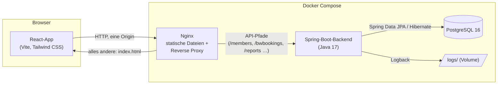
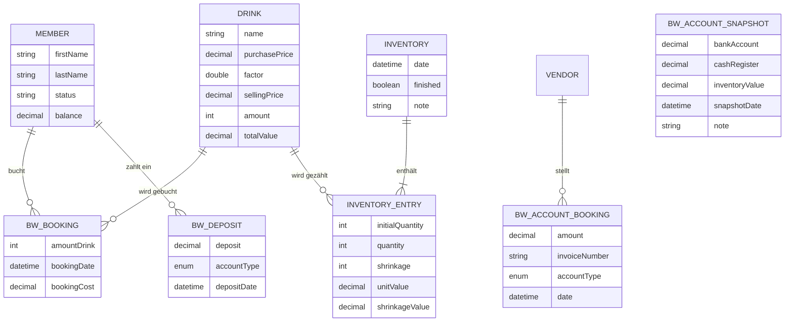

# Architektur

## Überblick



Der Frontend-Container (Nginx) ist der einzige von außen erreichbare Dienst. Er liefert die
gebaute React-App aus und leitet die API-Pfade an das Backend im internen Docker-Netzwerk weiter
([nginx.conf](../code/infra/nginx.conf)). In der Entwicklung übernimmt der Vite-Dev-Server mit
derselben Pfadliste diese Rolle, sodass der Frontend-Code in beiden Umgebungen identisch ist.

## Backend

```
src/main/java/de/tobi/asz_management_suite_api/
├── member/              # Mitglieder (inkl. eingebetteter Adresse)
├── familyLine/          # Familienlinien („Leibfamilien“)
├── position/            # Ämter je Semester (Senior, Fuxmajor, Bierwart …)
├── academicDegree/      # Akademische Grade
├── vendor/              # Lieferanten
├── credential/          # Passkey-Credentials (in Vorbereitung)
├── bierwart/
│   ├── drink/                # Getränke, Preise, Bestand
│   ├── bwBooking/            # Getränkebuchungen
│   ├── bwDeposit/            # Einzahlungen
│   ├── bwAccountBooking/     # Kontobewegungen (Rechnungen)
│   ├── bwAccountSnapshot/    # Kassenstände
│   ├── inventory/            # Inventuren
│   ├── inventoryEntry/       # Inventureinträge (Soll, Ist, Schwund)
│   └── bwReports/            # PDF-Berichte
├── enums/               # Status, Ämter, Semester, Kontoarten, Abschlüsse
└── config/              # CORS
```

- **Paketstruktur nach Fachbereich** (package by feature): Entity, Repository, Service und
  Controller eines Bereichs liegen zusammen.
- **Schichten:** Controller sind dünn und delegieren an Services; die Services enthalten die
  Fachlogik und rufen sich gegenseitig auf (z. B. Buchung → Mitglied → Getränk → Kassenstand).
- **Persistenz:** Spring Data JPA; das Schema wird aus den Entities erzeugt.
- **Enums mit Anzeigenamen:** Fachliche Werte (`ACTIVE_MEMBER`) werden als Text gespeichert und
  über einen eigenen Endpunkt mit deutschem Anzeigenamen („Bundesbruder“) an das Frontend
  geliefert – die Übersetzung liegt an einer Stelle. → [EnumController.java](../code/backend/enums/EnumController.java)
- **Logging:** Jede schreibende Operation wird mit IDs und Vorher-/Nachher-Werten protokolliert;
  Logback schreibt auf die Konsole und in tägliche, größenbegrenzte, komprimierte Logdateien.
  → [logback-spring.xml](../code/backend/resources/logback-spring.xml)

## Datenmodell (Bierwart)



`BW_ACCOUNT_SNAPSHOT` hat bewusst keine Fremdschlüssel: Ein Kassenstand ist ein unveränderlicher
Eintrag im Verlauf, der auch dann bestehen bleibt, wenn die auslösende Buchung gelöscht wird.

## REST-API

Alle Ressourcen folgen demselben Schema (`GET` Liste, `POST` anlegen, `PUT /{id}` ändern,
`DELETE /{id}` löschen):

| Ressource            | Zweck                               |
| -------------------- | ----------------------------------- |
| `/members`           | Mitglieder                          |
| `/drinks`            | Getränke                            |
| `/vendors`           | Lieferanten                         |
| `/bwbookings`        | Getränkebuchungen                   |
| `/bwdeposits`        | Einzahlungen                        |
| `/bwaccountbookings` | Kontobewegungen                     |
| `/bwsnapshots`       | Kassenstände                        |
| `/inventories`       | Inventuren (Anlegen erzeugt die Einträge) |
| `/inventoryentries`  | Inventureinträge (Zählen)           |

Dazu kommen lesende Endpunkte für Auswahllisten (`/enums/status`, `/account-types`) und die
Berichte:

| Endpunkt                                         | Ergebnis                      |
| ------------------------------------------------ | ----------------------------- |
| `GET /reports/bookings?dateFrom=…&dateTo=…`      | Bierliste als PDF             |
| `GET /reports/inventory/{inventoryId}`           | Inventurbericht als PDF       |

## Frontend

```
frontend/src/
├── pages/            # eine Seite je Bereich (Mitglieder, Bierwart-Unterseiten)
├── components/       # Dialoge zum Anlegen/Bearbeiten je Fachbereich, Layout mit Sidebar
├── types/            # TypeScript-Typen der API-Objekte
└── utils/            # Laden, Speichern/Löschen, Sortieren, Datums- und Namenshilfen
```

- **Seiten** laden ihre Daten beim Öffnen, halten Suche und Sortierung im lokalen State und
  zeigen eine Tabelle; Anlegen und Bearbeiten erfolgen im selben modalen Dialog.
- **Gemeinsame Hilfsfunktionen:** `saveEntity` entscheidet anhand der ID zwischen `POST` und
  `PUT` und lädt danach neu ([crudUtils.jsx](../code/frontend/crudUtils.jsx)); `sortBy` ist
  generisch typisiert und sortiert Zahlen numerisch und Texte deutsch
  ([sortUtils.tsx](../code/frontend/sortUtils.tsx)).
- **Migration nach TypeScript:** Neue und überarbeitete Komponenten werden in TypeScript
  geschrieben; die übrigen werden schrittweise umgestellt.

## Betrieb

| Container  | Image                                         | Aufgabe                                     |
| ---------- | --------------------------------------------- | ------------------------------------------- |
| `frontend` | `node:22-alpine` (Build) → `nginx:alpine`     | React-App ausliefern, API weiterleiten      |
| `backend`  | `maven:3.9` (Build) → `eclipse-temurin:17-jre` | Spring Boot, läuft als Nicht-Root-Benutzer |
| `db`       | `postgres:16`                                 | Daten in einem benannten Volume             |

Zugangsdaten kommen aus einer `.env`-Datei, die nicht im Repository liegt. Beide Builds prüfen
die Lizenzen ihrer Abhängigkeiten und legen die Lizenzhinweise mit ins Image.
