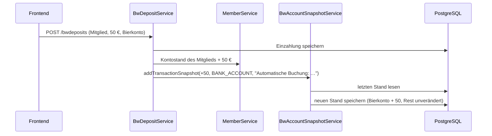
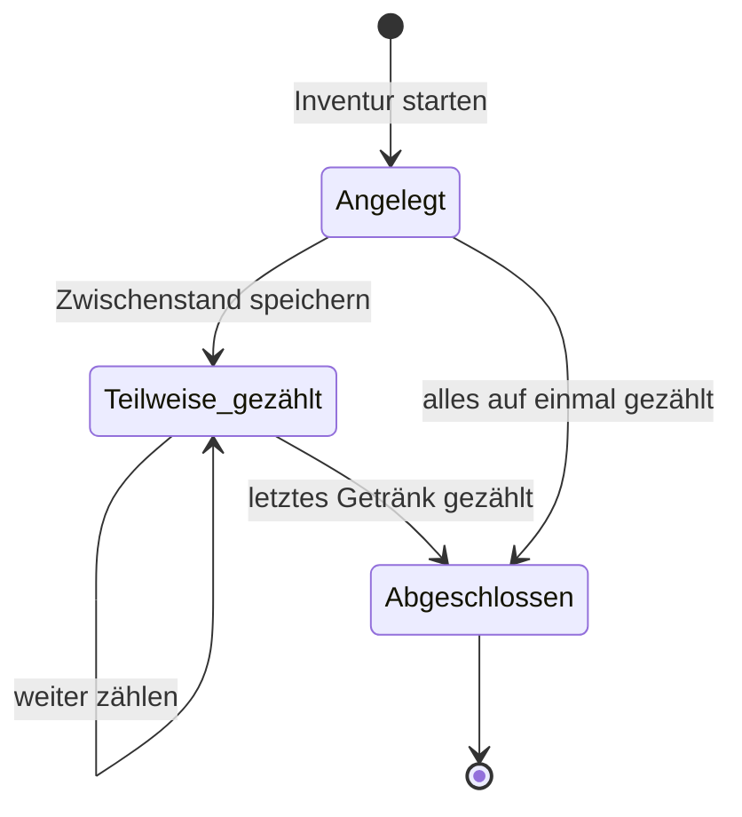

# Bierwart: Getränkekasse, Kassenstände und Inventur

Der Bierwart verwaltet in einer Studentenverbindung den Getränkeverkauf: Mitglieder nehmen sich
Getränke aus dem Kühlschrank, die auf ihr persönliches Konto gebucht werden, und laden ihr
Guthaben per Überweisung oder bar wieder auf. Dazu kommen Einkäufe bei Lieferanten und
regelmäßige Inventuren.

## Die drei Geldtöpfe

| Topf          | Bedeutung                                         | Wird verändert durch                          |
| ------------- | ------------------------------------------------- | --------------------------------------------- |
| **Bierkonto** | Bankkonto des Bierwarts (`BANK_ACCOUNT`)          | Einzahlungen per Überweisung, Rechnungen      |
| **Bierkasse** | Bargeld (`CASH_REGISTER`)                         | Bareinzahlungen, bar bezahlte Einkäufe        |
| **Inventar**  | Lagerwert aller Getränke zum Einkaufspreis (`INVENTORY`) | Getränke anlegen/ändern, Buchungen, Inventur |

Zusätzlich hat jedes Mitglied einen eigenen **Kontostand** (Guthaben minus verbrauchte Getränke).

## Kassenstände: eine Historie statt eines Zählers

Statt drei Zahlen zu überschreiben, legt jede Änderung einen neuen **Kassenstand** an
(`BwAccountSnapshot`). Er übernimmt die Werte des letzten Stands, verändert genau einen Topf und
speichert einen Kommentar, warum:

Das gilt für alle Buchungsarten:

| Vorgang                      | Mitgliedskonto | Bestand | Kassenstand                                   |
| ---------------------------- | -------------- | ------- | --------------------------------------------- |
| Einzahlung anlegen           | + Betrag       | –       | Bierkonto oder Bierkasse + Betrag             |
| Einzahlung ändern            | ± Differenz    | –       | „Automatische Korrekturbuchung“ über die Differenz |
| Einzahlung löschen           | − Betrag       | –       | „Automatische Rückbuchung“                    |
| Getränk buchen               | − Preis        | − Anzahl | Inventar − Anzahl × Einkaufspreis           |
| Rechnung (Kontobewegung)     | –              | –       | Bierkonto oder Bierkasse ± Betrag             |
| Getränk anlegen/ändern       | –              | ± Menge | Inventar ± Wertänderung                       |

Geänderte oder gelöschte Buchungen verschwinden damit nicht spurlos: Der Verlauf zeigt, wann
welcher Betrag korrigiert wurde. Die Übersichtsseite zeigt oben die aktuellen Werte der drei
Töpfe und darunter den durchsuch- und sortierbaren Verlauf.

## Preise

- **Verkaufspreis** = Einkaufspreis × Aufschlagsfaktor (wird im Backend berechnet, nicht im
  Formular eingegeben).
- **Lagerwert** eines Getränks = Einkaufspreis × Bestand.
- **Buchungspreis** = Anzahl × Verkaufspreis zum Zeitpunkt der Buchung; spätere Preisänderungen
  verändern alte Buchungen nicht.
- Alle Beträge sind `BigDecimal` (Java) bzw. `numeric` (PostgreSQL), nie Gleitkommazahlen.

## Mehrere Getränke in einem Dialog

Im Buchungsdialog wählt man ein Mitglied und beliebig viele Getränke: Sobald in der letzten Zeile
ein Getränk gewählt ist, erscheint automatisch eine neue leere Zeile. Beim Speichern wird pro
Getränk eine eigene Buchung angelegt – so bleiben Auswertungen pro Getränk einfach.
→ [BwBookingAddEdit.tsx](../code/frontend/BwBookingAddEdit.tsx)

## Inventur

1. **Starten:** Für jedes Getränk wird ein Inventureintrag mit eingefrorenem **Sollbestand**,
   **Stückwert** und **Gesamtwert** angelegt.
2. **Zählen:** Gezählte Mengen können in mehreren Etappen eingetragen werden. Für jede gezählte
   Zeile berechnet das Backend **Schwund** (Ist − Soll) und **Schwundwert** (Schwund × Stückwert).
3. **Abschließen:** Sobald alle Einträge gezählt sind, wird die Inventur automatisch als beendet
   markiert. Weicht der Istbestand ab, wird der Bestand des Getränks korrigiert – was wiederum
   einen Kassenstand für den Inventarwert erzeugt.
4. **Bericht:** Der Inventurbericht listet Soll, Ist, Differenz und Schwundwert pro Getränk.
   → [Beispiel](beispiele/inventory-report.pdf)

## Bierliste (PDF)

Für einen frei wählbaren Zeitraum erzeugt das Backend pro Mitglied eine Tabelle mit aktuellem
Kontostand (positiv grün, negativ rot), Summe der Einzahlungen und Ausgaben sowie die Getränke mit
Anzahl und Kosten. Das PDF wird im Speicher erzeugt und direkt als `application/pdf`
ausgeliefert, das Frontend öffnet es in einem neuen Tab.
→ [Beispiel](beispiele/bookings-report.pdf), [BookingsReportService.java](../code/backend/reports/BookingsReportService.java)
